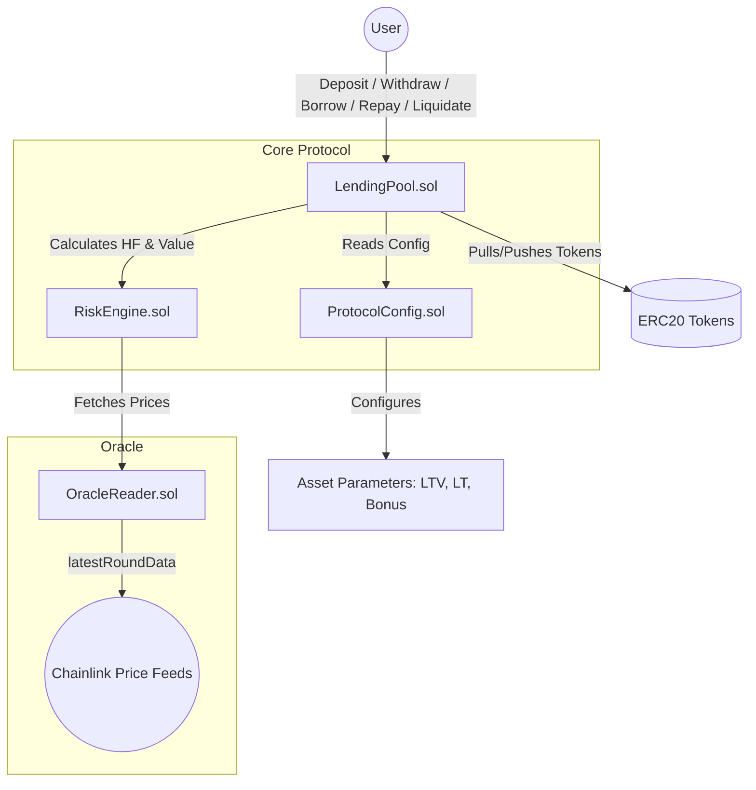

# LendX

LendX is a production-oriented, simplified Aave-style DeFi lending and borrowing protocol. It is designed to demonstrate deep smart contract engineering, rigorous security practices, and a comprehensive testing strategy (unit, fuzz, invariant, and fork testing).
The project includes a fully functional Next.js frontend to demonstrate end-to-end Web3 full-stack integration.

---
## Key Features

- **Lending & Borrowing**: Deposit ERC20 assets as collateral and borrow supported assets.
- **Risk Engine**: Real-time Health Factor calculations based on asset-specific LTV and Liquidation Thresholds.
- **Chainlink Oracle Integration**: Validates price feeds for staleness, invalid rounds, and decimal normalization.
- **Liquidations**: Highly precise liquidation mechanics with configurable bonuses, strictly following Checks-Effects-Interactions (CEI) and rounding directions that favor the protocol.
- **Security First**: Fail-closed oracle design, custom error handling, and protection against short-paying tokens.

---
## Architecture

LendX is built with a modular architecture to separate concerns:



---
## Testing & Security (Smart Contract Highlights)

This project places a heavy emphasis on smart contract correctness and security. The test suite is written in Foundry.

| Test Type           | Coverage & Focus                                                                                            | Status         |
| ------------------- | ----------------------------------------------------------------------------------------------------------- | -------------- |
| **Unit Tests**      | Core logic, failure paths, access control, state integrity, and 6-decimal vs 18-decimal precision.          | **161 passed** |
| **Fuzz Tests**      | Rounding directions (floor/ceil), bonus boundaries, and accounting invariants across random inputs.         | **10 passed**  |
| **Invariant Tests** | 25,600 calls per invariant. Proves token conservation (`pool + borrowed == supplied + seed`) and HF safety. | **1 passed**   |
| **Fork Tests**      | Real Chainlink feeds on Sepolia, stale price checks via `vm.warp`, and CEI reentrancy attacks.              | **3 passed**   |
### Security Review (Bounded)

- **CEI Ordering**: `liquidate` and `withdraw` update state before external calls. Verified by a malicious ERC20 reentrancy test.
- **Oracle Fail-Closed**: Operations revert if prices are stale or invalid, rather than using unsafe data.
- **Rounding**: All math favors the protocol (collateral value down, debt value up).

---
## Deployment (Sepolia Testnet)

The protocol is deployed and verified on the Ethereum Sepolia testnet.

- **LendingPool**: [0xeC8de0C9E429652F7541BD313cA51e944277aFB8](https://sepolia.etherscan.io/address/0xeC8de0C9E429652F7541BD313cA51e944277aFB8)
- **ProtocolConfig**: [0x8388c77999ebB82D53D4997CFE8e6cACDEA9A43e](https://sepolia.etherscan.io/address/0x8388c77999ebB82D53D4997CFE8e6cACDEA9A43e)
- **RiskEngine**: [0xEF6194e4C2B22d11008dD45424309eD4994c6F53](https://sepolia.etherscan.io/address/0xEF6194e4C2B22d11008dD45424309eD4994c6F53)
- **OracleReader**: [0x9b19CD6b433E9B151c2f11a174f72808B979d59d](https://sepolia.etherscan.io/address/0x9b19CD6b433E9B151c2f11a174f72808B979d59d)
- **Test Token (tUSD)**: [0xBCFf6dA2f6e00B66655954C87d6894cBa33777c7](https://sepolia.etherscan.io/address/0xBCFf6dA2f6e00B66655954C87d6894cBa33777c7)

See `docs/deployment.md` for the full deployment record and reproduction commands.

---
## Frontend

A modern Next.js frontend demonstrates full-stack Web3 capabilities:

- **Stack**: Next.js, React, TypeScript, wagmi v3, viem.
- **Features**: Wallet connection, network switching, real-time position/risk dashboard, ERC20 approval flow, and transaction lifecycle handling.
- Fully integrated with the Sepolia deployment.

---
## Quick Start

### Smart Contracts

```bash
# Install dependencies
forge install

# Run the complete test suite
forge test -vv
```

### Frontend

```bash
cd frontend
npm install
npm run dev
```

Open [http://localhost:3000](http://localhost:3000/)

---
## Known Limitations

This project is a portfolio demonstration and intentionally simplifies certain mechanics:

- No interest accrual (static debt balances).
- Close factor is 100% (liquidators may repay the entire debt in one call).
- No bad-debt write-down (insufficient collateral reverts).
- Testnet deployment uses mock tokens and mock feeds to allow permissionless demonstration. It is not intended for real-value usage.

---